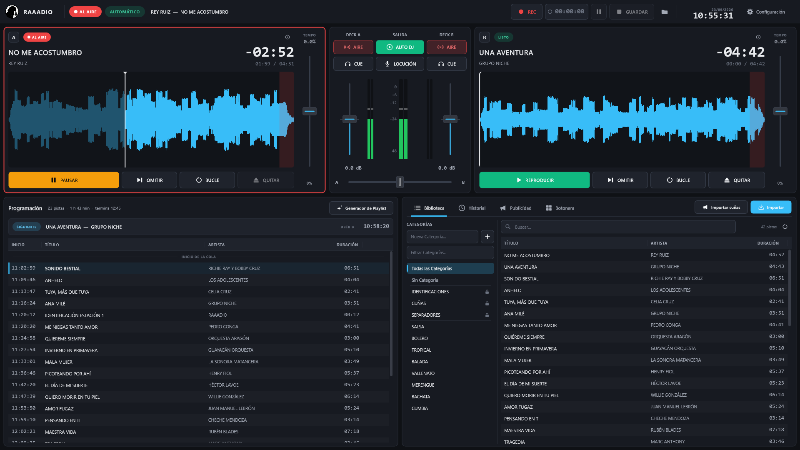
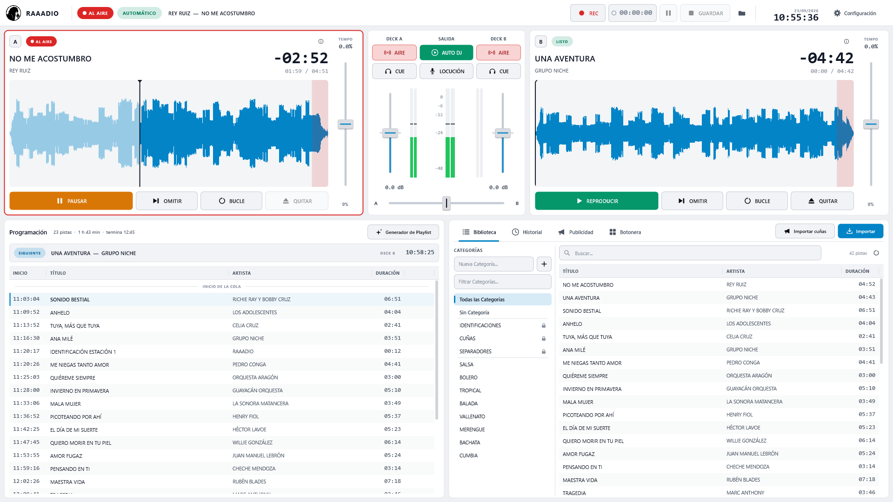
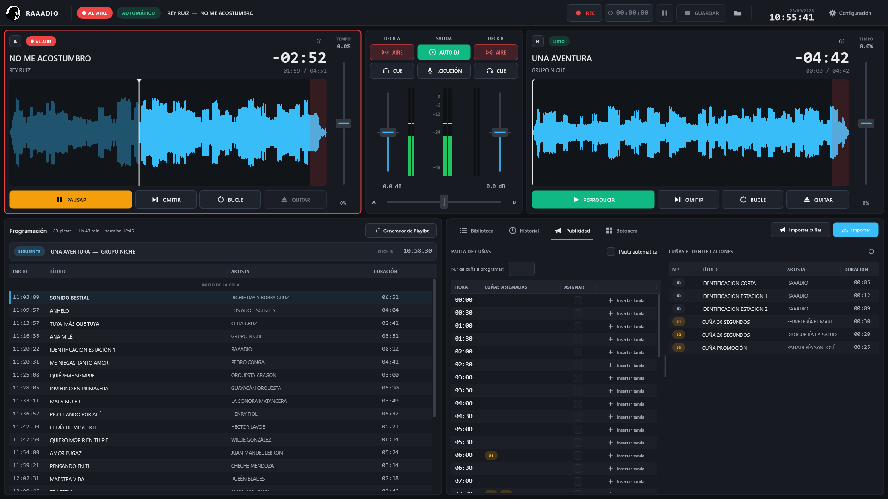
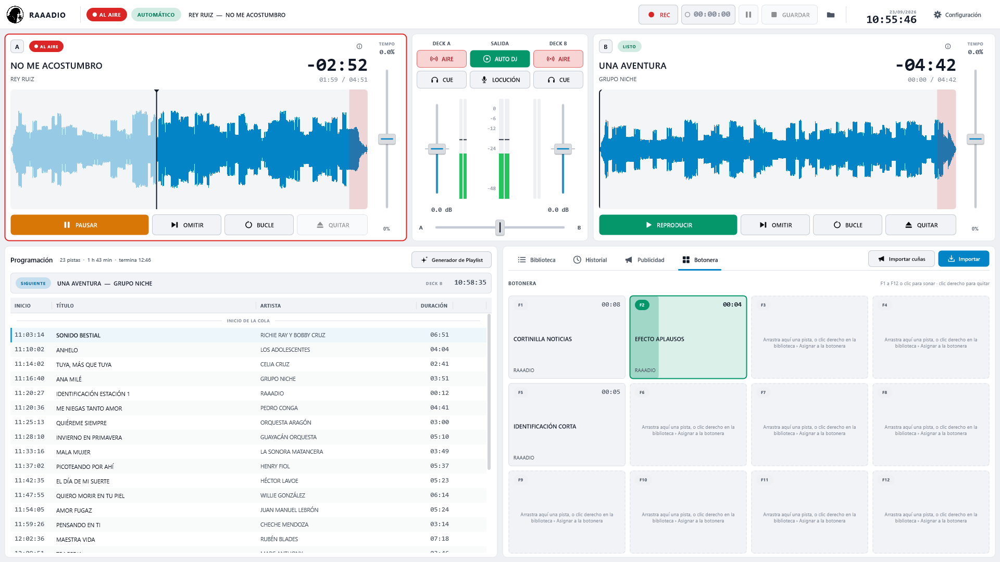
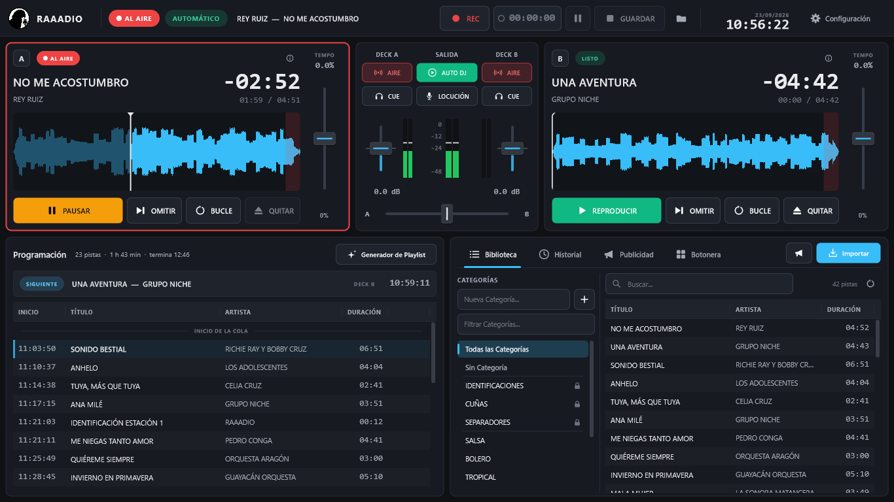
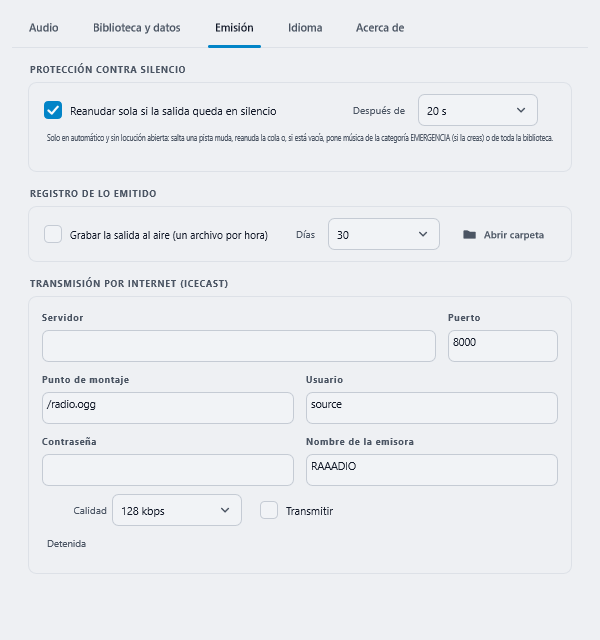
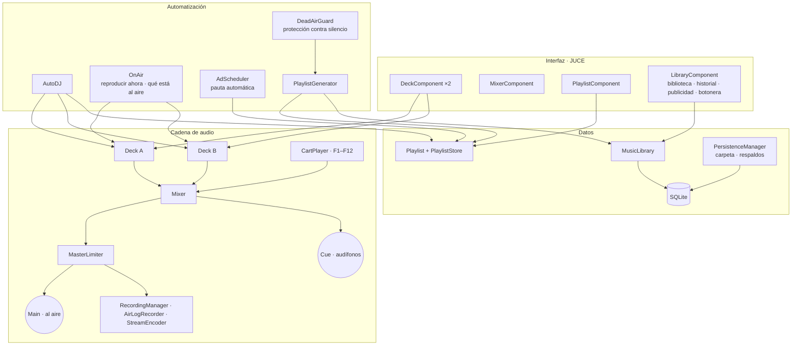

<div align="center">


# RAAADIO

**Sistema de automatización radial para emisoras comunitarias, universitarias e independientes.**

Doble deck, AutoDJ, programación musical por reglas, pauta publicitaria automática, botonera,
transmisión por internet y registro de lo emitido, en una sola aplicación de escritorio nativa.

<br/>

[](https://github.com/juanitomanoplateada/raaadio/actions/workflows/build.yml)
[](https://isocpp.org/)
[](https://juce.com/)
[](https://sqlite.org/)


[](LICENSE)

<br/>

[Capturas](#capturas) &nbsp;·&nbsp;
[Características](#características) &nbsp;·&nbsp;
[Instalación](#instalación) &nbsp;·&nbsp;
[Primeros pasos](#primeros-pasos) &nbsp;·&nbsp;
[Datos y respaldos](#datos-y-respaldos) &nbsp;·&nbsp;
[Arquitectura](#arquitectura) &nbsp;·&nbsp;
[Contribuir](#contribuir)

</div>

---

## Sobre el proyecto

Las emisoras comunitarias operan 24/7 con presupuestos que no alcanzan para licencias de
automatización comercial. La alternativa habitual (software descontinuado, reproductores
genéricos o cadenas de scripts) falla justo cuando no debe: al aire.

**RAAADIO** nace para cerrar esa brecha. Es una aplicación de escritorio nativa escrita en
C++17 sobre [JUCE 8](https://juce.com/), pensada para correr sin parar en equipos modestos,
con una interfaz en español y la terminología de una cabina de radio.

No requiere servidor, ni conexión a internet, ni servicios externos: toda la emisora vive
en una carpeta que se puede llevar en un disco externo.

<div align="center">

<br/>
<sub><i>Decks, mezclador, cola de programación y biblioteca en una sola pantalla.</i></sub>
</div>

---

## Capturas

<table>
  <tr>
    <td width="50%" align="center">
      
      <br/><sub><b>Tema claro</b> · la categoría fija de la emisora lleva candado</sub>
    </td>
    <td width="50%" align="center">
      
      <br/><sub><b>Publicidad</b> · pauta de cuñas por franjas, identificaciones y pauta automática</sub>
    </td>
  </tr>
  <tr>
    <td width="50%" align="center">
      
      <br/><sub><b>Botonera</b> · 12 cartuchos con F1–F12, directo al aire</sub>
    </td>
    <td width="50%" align="center">
      
      <br/><sub><b>Historial</b> · lo que salió al aire, con hora y deck</sub>
    </td>
  </tr>
  <tr>
    <td width="50%" align="center">
      
      <br/><sub><b>1366 × 768</b> · la interfaz se adapta a los monitores de cabina más comunes</sub>
    </td>
    <td width="50%" align="center">
      
      <br/><sub><b>Generador de listas</b> · reglas de separación, separadores y plantillas</sub>
    </td>
  </tr>
  <tr>
    <td width="50%" align="center">
      
      <br/><sub><b>Emisión</b> · protección contra silencio, registro de lo emitido y streaming</sub>
    </td>
    <td width="50%"></td>
  </tr>
</table>

---

## Características

### Motor de audio

| Componente | Descripción |
|---|---|
| **Doble deck** | Transporte independiente, velocidad con *resampling*, bucle y forma de onda. Cada deck lee el archivo en otro hilo con unos 3 s de ventaja: un disco lento o un USB que se demora no corta el aire. |
| **Salida Main / Cue** | Dos dispositivos de audio independientes: **Main** va al aire y **Cue** a los audífonos. La preescucha es antes del fader (PFL). |
| **Mezclador** | Crossfader suavizado, volumen por canal, medidores RMS y de pico, y **locución** con atenuación automática de la música. |
| **Limitador maestro** | Limitador de pico en la salida para evitar recortes al aire. |
| **Normalización por sonoridad** | Cada pista se mide una vez al importarla (EBU R 128, con [libebur128](https://github.com/jiixyj/libebur128)) y suena a −16 LUFS. Una pista suave solo se sube hasta que su pico real llega a −1 dBTP. |
| **Puntos de entrada y salida** | Se calculan al importar: la pista arranca donde empieza el sonido, deja el aire donde termina y la siguiente entra 3,5 s antes. Las pausas intencionales no la cortan; una "pista oculta" tras un silencio largo sí. |

### Automatización

- **AutoDJ.** Supervisa los decks, lanza la siguiente pista en su punto de mezcla y
  descarga la que termina. Cambia entre automático y manual sin interrumpir el aire.
- **Reproducir ahora.** La pista entra en el deck libre y lo que suena baja con un fundido
  de 2 s; si hay algo al aire, antes pregunta. Nunca corta en seco lo que oyen los oyentes.
- **Protección contra silencio.** Si la salida queda muda más de 20 s (configurable) en
  automático, salta una pista muda, reanuda la cola o la rellena con música de la categoría
  `EMERGENCIA` (si existe) o de toda la biblioteca. En manual o con la locución abierta, solo avisa.
- **Botonera.** 12 cartuchos para cortinillas y efectos con F1 a F12, directo al aire por
  encima de los decks, con la ganancia y los puntos de entrada y salida de su análisis.
- **Generador de listas por reglas.** Separación de artista, título, categoría y última
  reproducción; separadores cada N canciones; duración objetivo; plantillas reutilizables.

<details>
<summary><b>Parámetros del generador (valores por defecto)</b></summary>

<br/>

| Parámetro | Por defecto | Qué controla |
|---|:---:|---|
| `artistSeparation` | `5` | Pistas mínimas antes de repetir un artista |
| `titleSeparation` | `10` | Pistas mínimas antes de repetir un título |
| `categorySeparation` | `3` | Pistas mínimas antes de repetir una categoría |
| `lastPlayedSeparation` | `60` | Minutos mínimos desde la última reproducción |
| `targetDurationVal` | `60` | Duración objetivo del bloque (minutos u horas) |
| `separatorInterval` | `0` | Insertar un separador cada N pistas (`0` = desactivado) |
| `insertionMode` | `AddToEnd` | Añadir al final, al inicio o reemplazar la cola |

Sin categorías incluidas vale toda la música, también la que no tiene categoría; las
identificaciones, cuñas y separadores solo entran si se incluyen. Si una regla de
separación pide más variedad de la que hay, se limita a lo posible en lugar de dejar la
lista a medias.

</details>

### Categorías de la emisora

La biblioteca arranca sin géneros predefinidos: cada emisora crea los suyos. Tres categorías
son fijas, van siempre primero y no se renombran, mueven ni eliminan:

| Categoría | Qué va ahí |
|---|---|
| **IDENTIFICACIONES** | El nombre, la frecuencia y la ciudad de la emisora. Cada tanda abre con una al azar. |
| **CUÑAS** | La publicidad pagada, con número y horario en la pauta. |
| **SEPARADORES** | Cortinillas, jingles y promos entre canciones. |

La pauta, el generador y la protección contra silencio las reconocen por su rol, no por el
nombre: renombrar o traducir la interfaz no rompe la publicidad.

### Pauta publicitaria

- **Pauta de 24 horas** en franjas de 30 minutos: cada número de cuña se asigna a las franjas
  contratadas.
- **Pauta automática.** La tanda de cada franja (una identificación y sus cuñas) se inserta
  sola 20 minutos antes, en el punto de la cola donde empieza más cerca de su hora, sin cortar
  canciones. No se repite al reiniciar, y si la cola se vacía o se reemplaza antes de que la
  tanda suene, se vuelve a insertar.
- **Cuñas nuevas sin confusiones.** La cuña del mes se importa aunque se llame y dure igual
  que la anterior: en las categorías de la emisora solo cuenta como duplicado el mismo archivo.

### Emisión

- **Transmisión por internet** a un servidor Icecast en Ogg Vorbis (64 a 500 kbps), sin otro
  programa. Reconecta sola y los oyentes ven el título de lo que está al aire, no de lo que se
  preescucha. En Windows la clave se guarda cifrada (DPAPI).
- **Registro de lo emitido** (opcional): la salida al aire en archivos de una hora (Ogg Vorbis
  mono, unos 20 MB por hora) con días de retención; sirve como constancia ante el regulador.
- **Registro de emisión** en la base de datos (`play_log`): cada pista que sale al aire con
  hora, deck, título y artista. La preescucha no cuenta.
- **Grabadora** del bus maestro en un hilo propio, sin cortes por picos de carga.
- **API local** de "now playing" para RDS, sitios web o codificadores externos.

### Biblioteca

- **Importación** de archivos o carpetas eligiendo la categoría. Los archivos se copian tal
  cual (MP3, FLAC, OGG, WAV, AIFF; un WMA se pasa a FLAC, sin pérdida). Artista y título salen
  de las etiquetas (ID3, Vorbis, INFO de WAV) o del nombre `Artista - Título`.
- **Sin duplicados.** El mismo archivo, o la misma canción en otro formato, no se copia dos
  veces: importarla en otra categoría solo la suma a esa categoría.
- **Análisis en segundo plano** de lo importado con versiones anteriores, adelantando lo que
  está por sonar.
- **Cola persistente**: sobrevive a un cierre inesperado.

### Interfaz

- Temas **claro** y **oscuro**, iconos vectoriales y una distribución que funciona desde
  1366 × 768.
- **Bilingüe** (español e inglés), conmutable en caliente. Los textos van dentro del
  ejecutable: basta copiar `RAAADIO.exe`.

---

## Requisitos

| | Mínimo | Recomendado |
|---|---|---|
| **Sistema** | Windows 10 x64 | Windows 11 x64 |
| **Procesador** | Intel Core i3 / AMD Ryzen 3 | Core i5 / Ryzen 5 |
| **Memoria** | 4 GB | 8 GB |
| **Disco** | HDD | SSD |
| **Audio** | Una salida estéreo | Dos salidas (Main al aire y Cue a audífonos) |
| **Pantalla** | 1366 × 768 | 1920 × 1080 |

Para compilar: CMake ≥ 3.15, Git y un compilador C++17. En Windows, Visual Studio 2022 o sus
Build Tools con la carga de trabajo "Desarrollo de escritorio con C++".

> Las compilaciones de referencia, la integración continua y las pruebas se hacen en Windows
> x64. El código usa JUCE y debería compilar en Linux y macOS, pero allí no se prueba.

---

## Instalación

RAAADIO usa `FetchContent`: CMake descarga JUCE 8.0.3, SQLite y libebur128 por su cuenta.

```bash
git clone https://github.com/juanitomanoplateada/raaadio.git
cd raaadio
cmake -S . -B build -G "Visual Studio 17 2022" -A x64
cmake --build build --config Release --parallel
```

El ejecutable queda en `build/RAAADIO_artefacts/Release/RAAADIO.exe` y es autónomo: para
instalarlo en la máquina de aire basta copiar ese archivo.

<details>
<summary><b>La primera compilación tarda</b></summary>

<br/>

`FetchContent` descarga JUCE completo la primera vez (varios minutos según la conexión).
Las siguientes compilaciones reutilizan `build/_deps`. No borres `build/` salvo que necesites
una configuración limpia.

</details>

<details>
<summary><b>Linux y macOS (sin soporte oficial)</b></summary>

<br/>

En Linux, JUCE necesita las cabeceras de X11, ALSA y FreeType:

```bash
sudo apt install build-essential cmake git \
  libasound2-dev libjack-jackd2-dev \
  libx11-dev libxext-dev libxinerama-dev libxrandr-dev libxcursor-dev libxcomposite-dev \
  libfreetype6-dev libfontconfig1-dev libcurl4-openssl-dev
cmake -S . -B build && cmake --build build --config Release
```

En macOS, con las Xcode Command Line Tools: `cmake -S . -B build -G Xcode`.

Fuera de Windows la clave del streaming se guarda sin cifrar.

</details>

---

## Primeros pasos

1. **Elige la carpeta de la emisora.** En *Configuración → Biblioteca y datos*. Un disco
   externo o USB hace la instalación portable.
2. **Configura el audio.** En *Configuración → Audio*, la salida **Main** (al aire) y, si
   tienes una segunda interfaz, la salida **Cue** (audífonos).
3. **Importa la música** con *Importar*, eligiendo la categoría (crea tus géneros con el
   botón **+** de la barra de categorías). Las cuñas van con *Importar cuñas*.
4. **Carga las identificaciones y separadores** en sus categorías fijas.
5. **Programa la pauta** en la pestaña *Publicidad*: escribe el número de la cuña y marca
   sus franjas. Activa *Pauta automática* para que las tandas entren solas.
6. **Genera una lista** con el *Generador de Playlist* y guárdala como plantilla.
7. **Activa AutoDJ** y deja la emisora al aire.

---

## Datos y respaldos

Toda la emisora vive en una carpeta reubicable (por defecto `Documentos/raaadio`; al elegir
otra ubicación se usa `raaadio_lab` dentro de ella):

```
raaadio_lab/
├── Database/      # raaadio.db: pistas, categorías y registro de emisión (play_log)
├── Config/        # ads_data.json (pauta), station.json (emisión), cartwall.json (botonera),
│                  # queue.json (cola) y ad_breaks_done.json (tandas ya insertadas)
├── Library/       # la música y las cuñas, copiadas tal cual al importarlas
├── Recordings/    # grabaciones; Recordings/Registro guarda el registro de lo emitido
├── Templates/     # plantillas del generador
├── Backups/       # respaldos: AAAA/MM/DD/HH_MM_SS/
└── Logs/          # raaadio.log (se recorta a 5 MB al iniciar)
```

Las rutas de la biblioteca se guardan relativas a esta carpeta: sigue funcionando si el disco
cambia de letra o se lleva a otro equipo.

- **Respaldos.** Copia consistente de la base de datos (aunque la emisora esté al aire), la
  pauta, los ajustes, la botonera y las plantillas. Hay un respaldo automático diario al abrir
  (activado por defecto); se guardan 30 días y siempre los 10 más recientes.
- **Restaurar o importar** se prepara al momento y se aplica al volver a abrir RAAADIO, antes
  de abrir la base de datos y después de respaldar lo que había.
- **Mover la emisora.** *Mover o cambiar la carpeta* copia la emisora entera a otro disco
  (con avance, comprobación de espacio y opción de cancelar) o apunta a una que ya existe.
  Rige desde el próximo inicio; la carpeta anterior no se borra.
- **Borrar la biblioteca** hace un respaldo antes, y si no puede, no borra nada.

---

## API local

RAAADIO expone un servidor HTTP en `127.0.0.1:8080` con lo que está al aire, para alimentar
codificadores RDS, sitios web o servidores de streaming.

| Método | Endpoint | Respuesta | Content-Type |
|---|---|---|---|
| `GET` | `/nowplaying` | `Artista - Título` | `text/plain; charset=utf-8` |

```bash
curl http://127.0.0.1:8080/nowplaying
# GRUPO NICHE - UNA AVENTURA
```

La respuesta incluye `Access-Control-Allow-Origin: *`, así que se puede leer desde una página
local:

```js
const res = await fetch("http://127.0.0.1:8080/nowplaying");
document.querySelector("#now-playing").textContent = await res.text();
```

Solo cuenta lo que está al aire: una pista en preescucha no cambia la respuesta. Si suenan dos
decks (una mezcla), gana el que arrancó último; si no suena nada, devuelve el nombre de la
emisora.

> El servidor escucha solo en `127.0.0.1`. Exponerlo a la red requiere un proxy inverso, a
> propósito: la máquina de aire no queda abierta por defecto.

---

## Arquitectura



<details>
<summary><b>Organización del código fuente</b></summary>

<br/>

```
Source/
├── Main.cpp                  # Punto de entrada; una sola instancia; modo --ui-snapshot
├── MainComponent.*           # Composición y ciclo de vida de la aplicación
├── audio/
│   ├── AudioEngine.*         # Dispositivos Main y Cue, decks y mezclador
│   ├── Deck.*                # Transporte con lectura por adelantado, puntos de entrada/salida
│   ├── Mixer.*               # Crossfader, locución, medidores, FIFO de Cue, salidas del aire
│   ├── MasterLimiter.h       # Limitador de pico
│   ├── TrackAnalyzer.*       # Sonoridad (LUFS), pico real y puntos de entrada/salida
│   ├── CartPlayer.*          # Botonera F1–F12
│   ├── AirLogRecorder.*      # Registro de lo emitido, un archivo por hora
│   └── RecordingManager.*    # Grabación en un hilo propio
├── autodj/
│   ├── AutoDJ.*              # Mezcla automática entre decks
│   ├── OnAir.*               # Reproducir ahora y qué está al aire
│   ├── QueueTiming.*         # Hora de inicio de cada pista de la cola
│   ├── AdScheduler.*         # Tandas y pauta automática
│   └── DeadAirGuard.*        # Protección contra silencio
├── generator/                # Generador de listas por reglas y plantillas
├── library/                  # Biblioteca, etiquetas, cola, historial y pauta
├── database/Database.*       # SQLite: esquema, migraciones y consultas preparadas
├── network/
│   ├── ApiServer.*           # "Now playing" en 127.0.0.1:8080
│   └── StreamEncoder.*       # Transmisión a Icecast (Ogg Vorbis)
├── helpers/                  # Idioma, temas, estilo, carpeta y respaldos, ajustes, claves
└── ui/                       # Componentes y diálogos
Tests/RaaadioTests.cpp        # Pruebas automáticas (ctest)
Assets/                       # Icono, textos es/en y arte (se incrustan en el .exe)
docs/screenshots/             # Capturas del README (generadas con --ui-snapshot)
```

</details>

**Decisiones de diseño**

- **El hilo de audio nunca espera.** Los decks y la botonera leen el disco en otro hilo; la
  grabación, el registro, el streaming y la preescucha reciben el audio por colas sin bloqueo.
- **Lo que suena al aire manda.** "Reproducir ahora", el título del stream y la API solo
  consideran lo que va a la salida Main; nada corta el aire sin preguntar.
- **La publicidad no depende de nombres.** Las categorías de la emisora se reconocen por su rol.
- **La emisora es una carpeta.** El ejecutable no guarda estado: mover la carpeta mueve la
  emisora, y los respaldos y restauraciones nunca escriben sobre una base abierta.
- **Toda la interfaz es traducible.** Ninguna cadena visible va en el código; todas pasan por
  `TRANS()` y viven en `Assets/lang_*.txt`.

---

## Pruebas

```bash
ctest --test-dir build -C Release --output-on-failure
```

Más de 340 comprobaciones cubren la base de datos y sus migraciones, el análisis de audio,
las etiquetas, la importación, los decks, la cola, la pauta, la protección contra silencio,
la botonera, el streaming, los respaldos y "reproducir ahora". Corren en laboratorios
temporales, sin tocar la emisora real. La integración continua compila y prueba cada cambio
en Windows.

El ejecutable también puede renderizar la interfaz a un PNG con datos de demostración, sin
abrir dispositivos de audio (así se generan las capturas de este README):

```bash
RAAADIO.exe --ui-snapshot captura.png --size 1366x768 --theme dark --lang es --view ads
```

`--view` acepta `main`, `empty`, `history`, `ads`, `cartwall`, `settings`, `settings-library`,
`settings-broadcast`, `settings-language`, `settings-about`, `generator`, `track` e `import`.

---

## Hoja de ruta

- [x] Normalización por LUFS (EBU R 128) y puntos de entrada y salida
- [x] Pauta de 24 horas con tandas automáticas
- [x] Streaming integrado (Icecast, Ogg Vorbis)
- [x] Respaldos consistentes y emisora portable
- [ ] Streaming en MP3 (necesita LAME) para oyentes con iPhone, que no reproducen Ogg
- [ ] Exportar el registro de emisión para reportes al regulador
- [ ] Endpoint `/nowplaying.json` con metadatos estructurados
- [ ] Instalador y compilaciones firmadas

---

## Contribuir

Las contribuciones son bienvenidas, sobre todo de quienes operan emisoras. Lee
[CONTRIBUTING.md](CONTRIBUTING.md) para compilar, probar y proponer cambios; los problemas de
seguridad van por [SECURITY.md](SECURITY.md). Los cambios de cada versión están en
[CHANGELOG.md](CHANGELOG.md).

---

## Licencia

Distribuido bajo licencia MIT. Consulta [LICENSE](LICENSE).

---

<div align="center">

**Hecho para fortalecer la comunicación comunitaria.**

</div>
