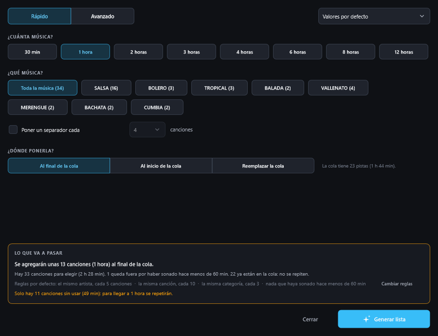
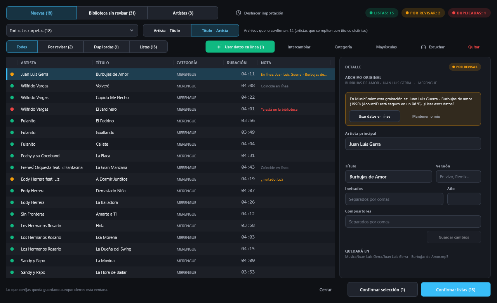
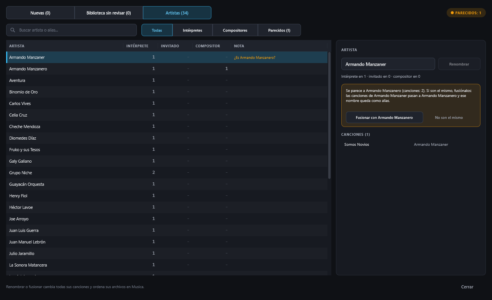
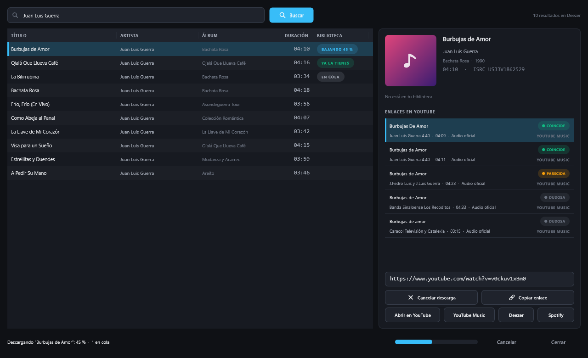
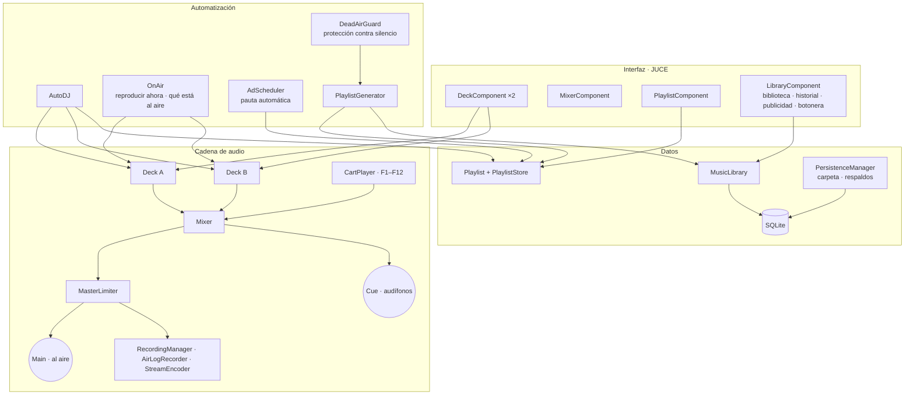

<p align="center">
  
</p>

<h1 align="center">RAAADIO</h1>

<p align="center">
  Automatización de radio para Windows: dos decks, AutoDJ, pauta publicitaria, streaming y
  respaldos en una sola aplicación de escritorio.
</p>

<p align="center">
  <a href="https://github.com/juanitomanoplateada/raaadio/actions/workflows/build.yml"></a>
  <a href="LICENSE"></a>
  
  
</p>

RAAADIO es el programa de la máquina de aire de una emisora pequeña: comunitaria, universitaria
o independiente. Reproduce la programación con dos decks y una cola, mezcla entre canciones,
inserta las tandas de publicidad a su hora, transmite a Icecast y deja constancia de lo que salió
al aire. Está escrito en C++17 sobre [JUCE 8](https://juce.com/) y guarda todo el estado en una
base SQLite dentro de una carpeta que se puede llevar a otro disco o a otro equipo.

No necesita servidor ni conexión a internet. Los servicios en línea (identificar canciones por
su sonido, buscar en Deezer y YouTube) son opcionales y todo lo demás funciona sin ellos. La
interfaz está en español e inglés y usa el vocabulario de una cabina: cuñas, tandas,
identificaciones, preescucha.

<p align="center">
  
</p>

## Contenido

- [Funciones](#funciones)
- [Capturas](#capturas)
- [Requisitos](#requisitos)
- [Compilar](#compilar)
- [Primeros pasos](#primeros-pasos)
- [Datos y respaldos](#datos-y-respaldos)
- [Transmisión por internet](#transmisión-por-internet)
- [API local](#api-local)
- [Desarrollo](#desarrollo)
- [Hoja de ruta](#hoja-de-ruta)
- [Contribuir](#contribuir)
- [Licencia](#licencia)

## Funciones

### Audio

- Dos decks que leen el archivo en otro hilo con unos 3 s de ventaja, para que un disco lento o
  un USB que se demora no corten el aire. Velocidad con remuestreo, bucle y forma de onda.
- Dos salidas independientes: Main va al aire y Cue a los audífonos, con preescucha antes del
  fader (PFL).
- Mezclador con crossfader, volumen por canal, medidores RMS y de pico, y locución con
  atenuación automática de la música. Un limitador de pico protege la salida maestra.
- Sonoridad uniforme. Cada pista se mide una vez al importarla (EBU R 128, con
  [libebur128](https://github.com/jiixyj/libebur128)) y suena a −16 LUFS; una pista suave solo
  se sube hasta que su pico real llega a −1 dBTP.
- Puntos de entrada, salida y mezcla calculados al importar. La pista arranca donde empieza el
  sonido y deja el aire donde termina; las pausas intencionales no la cortan, pero una pista
  oculta después de un silencio largo sí. El punto de mezcla es el momento en que solo queda el
  final que se desvanece (18 dB por debajo de su sonoridad, como mucho 10 s antes del final):
  ahí entra la siguiente canción y la anterior baja con un fundido de hasta 3 s. Las
  identificaciones, cuñas, separadores y todo lo que dura 10 s o menos se oye completo.

### Programación

- AutoDJ lanza cada pista en su punto de mezcla y descarga la que termina. Se pasa de
  automático a manual sin interrumpir el aire.
- *Reproducir ahora* pone la pista en el deck libre y baja lo que suena con un fundido de 2 s.
  Si hay algo al aire, pregunta antes; nunca corta en seco.
- Protección contra silencio. Si en automático la salida queda muda más de 20 s
  (configurable), salta la pista muda, reanuda la cola o la rellena con música de la categoría
  `EMERGENCIA`, o de toda la biblioteca si esa categoría no existe. En manual, o con la locución
  abierta, solo avisa.
- Botonera de 12 cartuchos (F1 a F12) para cortinillas y efectos, que suenan directo al aire
  por encima de los decks con la ganancia y los puntos de su análisis.
- Generador de listas por reglas, con un modo rápido (cuánta música, qué géneros y dónde
  ponerla) y uno avanzado (categorías incluidas y excluidas, separación de artista, título y
  categoría, tiempo desde la última reproducción, separadores y plantillas). Antes de generar
  muestra cuántas canciones hay para elegir, cuántas saldrán y qué puede salir mal; después
  dice qué hizo, y *Quitar lo generado* lo deshace. Continúa desde lo que ya está en la cola, así
  que se puede programar por bloques (una hora de salsa, otra de vallenato) sin repetir. La
  separación de artistas cuenta al intérprete: no pone seguidas "Eddy Herrera" y "Eddy Herrera
  feat. Liz".
- La cola se guarda en la base y sobrevive a un cierre inesperado.

<details>
<summary>Cómo decide el generador y sus valores por defecto</summary>

<br>

La lista siempre llega a la duración pedida. Las reglas son preferencias con un orden: primero
no repetir canciones, después separar artistas y por último cambiar de categoría. Si la
biblioteca no alcanza, cede primero la categoría (una categoría con muchas más canciones que las
demás se mezcla en proporción, en lugar de repetir las de las categorías pequeñas), luego
repite canciones y al final acerca los artistas. El resumen dice cuánto cedió. Una canción cuyo
archivo falta o que no tiene duración no se usa.

| Parámetro | Por defecto | Qué controla |
|---|:---:|---|
| `artistSeparation` | `5` | Canciones antes de repetir un artista (cuenta a los invitados) |
| `titleSeparation` | `10` | Canciones antes de repetir un título |
| `categorySeparation` | `3` | Canciones antes de repetir una categoría, si la biblioteca lo permite |
| `lastPlayedSeparation` | `60` | Minutos desde la última reproducción |
| `targetDurationVal` | `60` | Duración del bloque, en minutos u horas |
| `separatorInterval` | `0` | Un separador cada N canciones (`0`: ninguno) |
| `insertionMode` | `AddToEnd` | Al final de la cola, al principio o en su lugar |

Sin categorías incluidas vale toda la música, también la que no tiene categoría; las
identificaciones, cuñas y separadores solo entran si se incluyen. Un `0` apaga la regla. Una
lista no pasa de 3000 pistas.

</details>

### Publicidad

La biblioteca empieza sin géneros: cada emisora crea los suyos. Tres categorías son fijas, van
siempre primero y no se renombran, mueven ni eliminan.

| Categoría | Contenido |
|---|---|
| IDENTIFICACIONES | Nombre, frecuencia y ciudad de la emisora. Cada tanda abre con una al azar. |
| CUÑAS | Publicidad pagada, con número y horario en la pauta. |
| SEPARADORES | Cortinillas, jingles y promociones entre canciones. |

La pauta, el generador y la protección contra silencio reconocen estas categorías por su rol y
no por el nombre, así que traducir la interfaz o cambiar el texto no rompe la publicidad.

La pauta cubre las 24 horas en franjas de 30 minutos y a cada número de cuña se le asignan las
franjas contratadas. Con la pauta automática, la tanda de cada franja (una identificación y sus
cuñas) se inserta sola 20 minutos antes, en el punto de la cola que empieza más cerca de su hora
y sin cortar canciones. No se duplica al reiniciar, y si la cola se vacía o se reemplaza antes de
que suene, se vuelve a insertar. La cuña del mes se importa aunque se llame y dure igual que la
anterior: en las categorías fijas solo cuenta como duplicado el mismo archivo.

### Biblioteca

Se importan archivos o carpetas eligiendo la categoría. MP3, FLAC, OGG, WAV y AIFF se copian tal
cual; un WMA se convierte a FLAC sin pérdida. Las notas de voz y los audios de WhatsApp (Opus,
`.mpeg`), M4A, AAC y AMR se convierten a FLAC con FFmpeg; si falta, RAAADIO ofrece instalarlo. Un
`.mpeg` que en realidad es MP3 se guarda como `.mp3`, sin recodificar.

La música importada entra *por revisar*. Se puede poner al aire a mano, pero AutoDJ y el
generador no la usan hasta que alguien confirma artista, título y categoría. Las cuñas,
identificaciones y separadores no pasan por la revisión. La ventana de revisión:

- detecta el formato de cada carpeta (`Artista - Título` o `Título - Artista`), porque los
  artistas se repiten con títulos distintos y los títulos no; si una carpeta no da pistas, la
  marca para que se elija con un clic;
- separa los créditos: intérprete principal, invitados (`feat.`, `canta`), compositores entre
  paréntesis, año, versión (`En vivo`, `Remix`) y el género pegado al nombre, y quita el número
  de pista, `(Video Oficial)`, direcciones web y sufijos de copias;
- guarda cada artista una sola vez, con una clave que ignora mayúsculas y tildes; recuerda las
  correcciones como alias y sugiere *¿Es…?* cuando un nombre se parece a otro conocido;
- detecta duplicados por contenido (SHA-256), por artista, título y duración, y por su sonido,
  con una huella acústica propia (10 s en 33 bandas) que reconoce la misma grabación en otro
  formato, más baja o con otro nombre. Quitar una copia pasa sus categorías a la otra, y lo
  quitado va a `Library/_Descartadas`: no se borra nada. Importar en otra categoría una canción
  que ya está no la copia de nuevo; solo la suma a esa categoría;
- permite deshacer una importación: lo que sigue por revisar de ese lote sale de la biblioteca
  y lo ya confirmado se queda;
- trabaja por lotes (intercambiar artista y título, categoría, mayúsculas), con preescucha por
  Cue y atajos de teclado. Lo corregido se conserva aunque se cierre la ventana;
- sanea también la *Biblioteca sin revisar*, lo importado con versiones anteriores, sin sacarlo
  del aire. Esa música se analiza en segundo plano, adelantando lo que está por sonar.

Con una clave gratuita de [AcoustID](https://acoustid.org/new-application) (opcional, en
*Configuración → Biblioteca y datos*) cada canción por revisar se reconoce por su sonido con
Chromaprint y sus datos se completan desde [MusicBrainz](https://musicbrainz.org): artista con
invitados, título, año, compositores e ISRC. Aparecen como sugerencia con su porcentaje de
confianza y nunca se aplican solos; si coinciden con lo propuesto, confirman el formato de la
carpeta y devuelven las tildes que el nombre del archivo había perdido. Solo se envían la huella
y la duración, nunca el audio.

Al confirmar, cada canción queda en `Library/Musica/<Artista>/<Artista> - <Título>`, y editarla
después la mueve; si está sonando, se mueve en el siguiente inicio. Después de restaurar un
respaldo viejo, los archivos se vuelven a encontrar por su huella. Desde la pestaña *Artistas*
se renombra un artista en todas sus canciones y archivos, o se fusionan dos que son el mismo
("Wilfridovargas" y "Wilfrido Vargas"); el nombre equivocado queda como alias.

La búsqueda usa FTS5 de SQLite, ignora mayúsculas y tildes, busca por partes de palabras y
también por invitados, compositores, versión, año y nombre original del archivo: `carino`
encuentra `Cariño` y `wilf` encuentra a Wilfrido Vargas. Los nombres se guardan bien escritos
(`Juan Luis Guerra`) y se pueden mostrar en mayúsculas en pantalla y en la transmisión.

<details>
<summary>Buscar y descargar canciones de internet</summary>

<br>

El globo junto al buscador (o *Buscar «…» en internet* cuando la biblioteca no tiene la canción)
consulta [Deezer](https://developers.deezer.com), sin clave ni cuenta: artista, título, álbum,
año, duración, ISRC y carátula. Marca lo que la emisora ya tiene aunque esté escrito distinto.
Para la canción elegida busca la misma grabación en YouTube Music, y en YouTube si allí no
aparece. Los videos se ordenan por título, artista, duración y tipo (el audio oficial primero;
en vivo, karaoke y versiones al final) y se marcan como *Coincide*, *Parecida* o *Dudosa*. El
enlace se copia con `Ctrl+C` o se abre, igual que la canción en Deezer y su búsqueda en Spotify.

La descarga usa [yt-dlp](https://github.com/yt-dlp/yt-dlp) para bajar el audio y FFmpeg para
pasarlo a MP3 (VBR de máxima calidad). Las etiquetas se escriben con los datos de Deezer
(artista con invitados, título, álbum, año, ISRC y el enlace de origen) y la canción entra por
revisar a `Library/_Entrada`, en un lote propio que se puede deshacer. La
primera vez, RAAADIO ofrece instalar yt-dlp, FFmpeg y Deno (unos 140 MB desde sus publicaciones
oficiales en GitHub, con el SHA-256 verificado) en `%LOCALAPPDATA%\RAAADIO\Herramientas`; si ya
están en el `PATH`, usa esos. yt-dlp se actualiza una vez al día.

Para no terminar bloqueado por YouTube, la búsqueda hace un pedido a la vez, con pausa y solo
para la canción que se está mirando, sin repetir lo ya encontrado; si YouTube pide esperar
(HTTP 429), no busca nada durante 15 minutos. Las descargas van de a una, con al menos 20 s
(más un poco al azar) entre una y otra y no más de 20 por hora. Si YouTube responde que se pidió
demasiado o pide confirmar que no es un robot, la fila se detiene una hora (o seis) y la pausa se
mantiene aunque se cierre el programa. Cancelar cierra yt-dlp y FFmpeg por completo, porque corren
dentro de un *job object* de Windows. Cada intento queda anotado en la base.

La primera descarga muestra un aviso: bajar de YouTube va contra sus términos de uso, y emitir
música requiere las licencias de comunicación pública del país.

</details>

### Emisión y registro

- Transmisión a Icecast, Zeno.fm y servidores compatibles, sin programas aparte: MP3 de 64 a
  320 kbps (con LAME) u Ogg Vorbis, con conexión cifrada (TLS) opcional. Reconecta sola y guarda
  la clave cifrada con DPAPI de Windows.
- El título que ven los oyentes es `Artista - Título` y corresponde solo a lo que está al aire,
  no a la preescucha. Durante las tandas muestra el nombre de la emisora. En MP3 viaja por
  `/admin/metadata` y se puede retrasar unos segundos para que cambie junto con el audio.
- La señal transmitida tiene un techo de −1 dBFS, para que los picos que agrega la compresión no
  saturen en el reproductor del oyente.
- Registro de lo emitido (opcional): la salida al aire en archivos de una hora (Ogg Vorbis mono,
  unos 20 MB por hora) con días de retención, como constancia ante el regulador.
- Historial de emisión en la base (`play_log`), con hora, deck, título y artista de cada pista
  que salió al aire.
- Grabadora del bus maestro en un hilo propio.
- Lo que suena (anterior, actual y siguientes) en JSON, por la [API local](#api-local) y, si se
  configura, enviado a la página web de la emisora.

### Interfaz

Temas claro y oscuro, iconos vectoriales y una distribución que funciona desde 1366 × 768. El
idioma cambia en caliente entre español e inglés. Los textos y el arte van dentro del
ejecutable: para instalar basta copiar `RAAADIO.exe`, más `libmp3lame.dll` para transmitir en
MP3 y `chromaprint.dll` para identificar canciones en línea.

## Capturas

<table>
  <tr>
    <td width="50%" align="center">
      <br>
      <sub>Tema claro. La categoría fija de la emisora lleva candado.</sub>
    </td>
    <td width="50%" align="center">
      <br>
      <sub>Pauta de cuñas por franjas, identificaciones y pauta automática.</sub>
    </td>
  </tr>
  <tr>
    <td width="50%" align="center">
      <br>
      <sub>Botonera de 12 cartuchos con F1 a F12.</sub>
    </td>
    <td width="50%" align="center">
      <br>
      <sub>Historial de lo que salió al aire, con hora y deck.</sub>
    </td>
  </tr>
  <tr>
    <td width="50%" align="center">
      <br>
      <sub>La interfaz en un monitor de cabina de 1366 × 768.</sub>
    </td>
    <td width="50%" align="center">
      <br>
      <sub>Generador de listas en modo rápido, con el resumen de lo que va a hacer.</sub>
    </td>
  </tr>
  <tr>
    <td width="50%" align="center">
      <br>
      <sub>Ajustes de emisión: protección contra silencio, registro y streaming.</sub>
    </td>
    <td width="50%" align="center">
      <br>
      <sub>Revisión de lo importado: formato por carpeta, créditos, dudas y duplicados.</sub>
    </td>
  </tr>
  <tr>
    <td width="50%" align="center">
      <br>
      <sub>Artistas: renombrar y fusionar, con alias y parecidos.</sub>
    </td>
    <td width="50%" align="center">
      <br>
      <sub>Búsqueda en internet: datos de Deezer y el video de YouTube que coincide.</sub>
    </td>
  </tr>
</table>

## Requisitos

| | Mínimo | Recomendado |
|---|---|---|
| Sistema | Windows 10 x64 | Windows 11 x64 |
| Procesador | Intel Core i3 o AMD Ryzen 3 | Core i5 o Ryzen 5 |
| Memoria | 4 GB | 8 GB |
| Disco | HDD | SSD |
| Audio | Una salida estéreo | Dos salidas: Main al aire y Cue a audífonos |
| Pantalla | 1366 × 768 | 1920 × 1080 |

Para compilar hacen falta CMake 3.15 o posterior, Git y un compilador de C++17. En Windows,
Visual Studio 2022 o sus Build Tools con la carga de trabajo *Desarrollo de escritorio con C++*.
Las compilaciones de referencia, la integración continua y las pruebas se hacen en Windows x64;
el código debería compilar en Linux y macOS, pero ahí no se prueba.

## Compilar

CMake descarga las dependencias con `FetchContent`: JUCE 8.0.3, SQLite, libebur128, LAME 3.100 y
Chromaprint 1.5.1.

```bash
git clone https://github.com/juanitomanoplateada/raaadio.git
cd raaadio
cmake -S . -B build -G "Visual Studio 17 2022" -A x64
cmake --build build --config Release --parallel
```

El ejecutable queda en `build/RAAADIO_artefacts/Release/RAAADIO.exe` y no necesita instalación.
Junto a él quedan `libmp3lame.dll` y `chromaprint.dll`, con sus licencias: cópialas al lado del
`.exe` en la máquina de aire. Sin `libmp3lame.dll` RAAADIO transmite en Ogg Vorbis, y sin
`chromaprint.dll` funciona todo menos la identificación en línea.

La primera configuración descarga JUCE completo y tarda varios minutos; las siguientes
reutilizan `build/_deps`.

<details>
<summary>Linux y macOS (sin soporte oficial)</summary>

<br>

En Linux, JUCE necesita las cabeceras de X11, ALSA y FreeType:

```bash
sudo apt install build-essential cmake git \
  libasound2-dev libjack-jackd2-dev \
  libx11-dev libxext-dev libxinerama-dev libxrandr-dev libxcursor-dev libxcomposite-dev \
  libfreetype6-dev libfontconfig1-dev libcurl4-openssl-dev
cmake -S . -B build && cmake --build build --config Release
```

En macOS, con las Xcode Command Line Tools: `cmake -S . -B build -G Xcode`.

Fuera de Windows la clave del streaming se guarda sin cifrar, y para transmitir en MP3 hace falta
la biblioteca LAME del sistema (`libmp3lame`; en Debian y Ubuntu, `sudo apt install libmp3lame0`).

</details>

## Primeros pasos

1. Elige la carpeta de la emisora en *Configuración → Biblioteca y datos*. En un disco externo o
   un USB, la instalación queda portable.
2. En *Configuración → Audio*, elige la salida Main (al aire) y, si tienes una segunda interfaz,
   la salida Cue (audífonos).
3. Crea tus géneros con el botón **+** de la barra de categorías e importa la música con
   *Importar*. Al terminar se abre la revisión: *Confirmar listas* pasa a AutoDJ todo lo que no
   tiene dudas. Las cuñas van con *Importar cuñas* y no necesitan revisión.
4. Carga las identificaciones y los separadores en sus categorías fijas.
5. En la pestaña *Publicidad*, escribe el número de cada cuña y marca sus franjas. Con *Pauta
   automática* las tandas entran solas.
6. Genera una lista con el *Generador de Playlist*. En el modo rápido basta elegir cuánta música
   y oprimir *Generar lista*.
7. Activa AutoDJ.

## Datos y respaldos

La emisora completa vive en una carpeta. Por defecto es `Documentos/raaadio`; si se elige otra
ubicación, se usa `raaadio_lab` dentro de ella.

```text
raaadio_lab/
├── Database/      raaadio.db: pistas, categorías, pauta, cola, botonera, ajustes,
│                  plantillas e historial de emisión
├── Library/       música y cuñas: Musica/<Artista>/ (confirmada), _Entrada/ (por revisar),
│                  _Descartadas/ (quitada en la revisión) y una carpeta por categoría fija
├── Recordings/    grabaciones; AirLog/ guarda el registro de lo emitido
├── Backups/       respaldos verificados: AAAA/MM/DD/HH_MM_SS/{raaadio.db, manifest.json}
├── Logs/          raaadio.log (se recorta a 5 MB al iniciar)
└── raaadio.lock   equipo que tiene la emisora abierta
```

Todo el estado está en SQLite y cada cambio es una transacción. El diario clásico con
`synchronous=FULL` resiste un corte de luz también en un USB o un disco de red. Las claves
foráneas impiden que la pauta, la cola o la botonera apunten a una pista borrada, y un respaldo es
un solo archivo coherente. Las rutas de la música se guardan relativas a la carpeta, así que la
emisora sigue funcionando si el disco cambia de letra o se lleva a otro equipo. Las versiones
anteriores guardaban la pauta, la cola, la botonera, los ajustes y las plantillas en `Config/` y
`Templates/`; al abrir la emisora por primera vez se importan a la base y quedan como
`*.migrated`.

Respaldos y protección de los datos (*Configuración → Biblioteca y datos*):

- Respaldo diario a una hora fija (03:00 por defecto) mientras la emisora está abierta, y al
  abrirla si esa hora pasó sin respaldo. Corre en un hilo de baja prioridad que no compite con
  los decks.
- Cada respaldo es una copia consistente de la base, aunque esté al aire. Pasa
  `PRAGMA quick_check` antes de contarse y lleva un `manifest.json` con versión, fecha y SHA-256.
  Al restaurar se comprueba de nuevo, y un respaldo alterado no se usa.
- Destino externo: otro disco, un USB o una carpeta de OneDrive o Google Drive. El respaldo se
  copia a `RAAADIO-<id>/Backups/` (aparece completo o no aparece) y la música a
  `RAAADIO-<id>/Library/`, solo lo nuevo, verificando cada archivo con el SHA-256 que guarda la
  base y sin borrar nunca nada allá. Si el destino no está conectado, se reintenta cada 30 minutos.
- Retención escalonada, igual en la carpeta local y en el destino externo: los 10 más recientes y
  el último de cada día (14 días), de cada semana (8 semanas) y de cada mes (12 meses).
- Si al abrir la base está dañada, se aparta como `raaadio.db.damaged-FECHA` y se pone la del
  último respaldo verificado, con un aviso.
- La barra superior avisa de un respaldo de más de 36 horas, de un respaldo o una copia externa
  fallidos y de poco espacio en el disco (menos de 5 GB o del 5 %; crítico con menos de 1 GB).
- Restaurar o importar un respaldo se prepara al momento y se aplica al volver a abrir RAAADIO,
  antes de abrir la base y después de respaldar lo que había. La cola y las tandas ya insertadas
  se conservan. Los respaldos de versiones anteriores también sirven.
- La emisora se abre en un solo equipo a la vez. Si está abierta en otro (un USB o un disco de
  red), RAAADIO avisa; el candado de un equipo que se cerró mal se libera solo.
- *Mover o cambiar la carpeta* copia la emisora a otro disco, con avance, comprobación de espacio
  y opción de cancelar, o apunta a una carpeta existente. Rige desde el siguiente inicio y la
  carpeta anterior no se borra.
- *Borrar la biblioteca* hace un respaldo antes; si no puede, no borra nada.

## Transmisión por internet

Se configura en *Configuración → Emisión → Transmisión por internet* con los mismos datos que
pide BUTT. Por ejemplo, para Zeno.fm, cuyo panel muestra los datos del codificador:

| Zeno.fm / BUTT | RAAADIO | Ejemplo |
|---|---|---|
| Dirección | Servidor | `link.zeno.fm` |
| Puerto | Puerto | `80` |
| Punto de montaje | Punto de montaje | el que da Zeno, con o sin `/` |
| Usuario | Usuario | `source` |
| Contraseña | Contraseña | la que da Zeno |
| Formato | Formato y Calidad | MP3, 128 kbps (el mismo que eligió en el panel de Zeno) |

Al marcar *Transmitir*, el estado pasa a *Transmitiendo*. RAAADIO se conecta con `PUT`, el método
de Icecast 2.4 en adelante, y si el servidor no lo acepta prueba con `SOURCE`, el método antiguo
que usa BUTT.

La conexión cifrada (TLS) conviene siempre que el servidor la acepte en ese puerto (caster.fm sí).
Además de proteger la clave, evita que un firewall que inspecciona el tráfico web, como
FortiGate, confunda el MP3 con peticiones a páginas y corte la transmisión al rato de empezar la
música. En Windows usa el cifrado del sistema (Schannel) con TLS 1.2 y valida el certificado del
servidor.

Si la transmisión se cae, las líneas `StreamEncoder` de `Logs/raaadio.log` dicen quién cortó, a
los cuántos segundos, cuánto audio salió y qué respondió el servidor; si respondió con una página,
se guarda completa en `%TEMP%\raaadio_stream_server_message.html`. Cuando el servidor corta a los
pocos segundos, RAAADIO espera cada vez más antes de reintentar (hasta 30 s), porque algunos
servicios bloquean al emisor que insiste. Revisa también el bitrate máximo de tu plan: el gratuito
de caster.fm admite 96 kbps.

MP3 lo abre cualquier reproductor. Ogg Vorbis suena mejor con los mismos kbps, pero Zeno.fm no lo
acepta y algunos reproductores, sobre todo en iPhone, no lo abren. En MP3 el título viaja aparte,
a `/admin/metadata` del mismo servidor; si en la app de Zeno cambia unos segundos antes que la
canción, sube *Retrasar el título*. El protocolo tiene un solo campo de texto (`StreamTitle`), por
eso el título es siempre `Artista - Título`, que es lo que las apps usan para buscar la carátula;
lo anterior y lo siguiente van en el JSON de la API local.

## API local

RAAADIO sirve lo que está al aire por HTTP en `127.0.0.1:8080`, para codificadores RDS,
pantallas de cabina, OBS o scripts propios.

| Método | Ruta | Respuesta | Content-Type |
|---|---|---|---|
| `GET` | `/nowplaying` | `Artista - Título` | `text/plain; charset=utf-8` |
| `GET` | `/nowplaying.json` | anterior, actual y siguientes | `application/json; charset=utf-8` |

```bash
curl http://127.0.0.1:8080/nowplaying
# GRUPO NICHE - UNA AVENTURA
```

```jsonc
// curl http://127.0.0.1:8080/nowplaying.json
{
  "station": "RAAADIO FM",
  "state": "music",                      // "music", "break" (cuña, identificación, separador) u "off"
  "updated": "2026-09-24T16:59:21.000-05:00",
  "now": {                               // null durante una tanda o si no suena nada
    "artist": "GRUPO NICHE", "title": "UNA AVENTURA", "text": "GRUPO NICHE - UNA AVENTURA",
    "duration": 283, "started": "2026-09-24T16:57:10.000-05:00", "ends": "2026-09-24T17:01:49.000-05:00"
  },
  "previous": [                          // la más reciente primero, hasta 5
    { "artist": "REY RUIZ", "title": "NO ME ACOSTUMBRO", "text": "REY RUIZ - NO ME ACOSTUMBRO",
      "duration": 291, "played": "2026-09-24T16:52:22.000-05:00" }
  ],
  "next": [                              // hasta 3; "eta" es null si no se sabe
    { "artist": "RICHIE RAY Y BOBBY CRUZ", "title": "SONIDO BESTIAL", "text": "…",
      "duration": 411, "eta": "2026-09-24T17:01:49.000-05:00" }
  ]
}
```

Solo cuenta la música que va a la salida Main: una pista en preescucha no cambia nada, y las
cuñas, identificaciones y separadores no aparecen entre las anteriores ni las siguientes. Si
suenan dos decks a la vez (en una mezcla), gana el que arrancó último. Las respuestas incluyen
`Access-Control-Allow-Origin: *`, de modo que una página local puede leerlas:

```js
const res = await fetch("http://127.0.0.1:8080/nowplaying.json");
const np = await res.json();
document.querySelector("#now-playing").textContent = np.now ? np.now.text : np.station;
```

El servidor escucha solo en `127.0.0.1`. Para exponerlo a la red hace falta un proxy inverso; es
una decisión deliberada para que la máquina de aire no quede abierta por defecto.

Para la página web de la emisora, en *Configuración → Emisión → Enviar a la página web* se escribe
la dirección de un script propio. RAAADIO le envía el mismo JSON por `POST` en cada cambio y una
vez por minuto, y la pestaña muestra si el último envío llegó. RAAADIO no envía credenciales: pon
una clave larga en la dirección y compruébala en el servidor. Un receptor mínimo en PHP que deja
el JSON en `ahora.json`:

```php
<?php // ahora.php — en RAAADIO: https://tusitio.com/ahora.php?clave=UNA-CLAVE-LARGA
if (!hash_equals('UNA-CLAVE-LARGA', $_GET['clave'] ?? '')) { http_response_code(403); exit; }
$json = file_get_contents('php://input');
if (json_decode($json) === null) { http_response_code(400); exit; }
file_put_contents(__DIR__ . '/ahora.json', $json, LOCK_EX);
```

## Desarrollo

### Arquitectura



Criterios que guían el diseño:

- El hilo de audio nunca espera. Los decks y la botonera leen el disco en otro hilo, y la
  grabación, el registro, el streaming y la preescucha reciben el audio por colas sin bloqueo.
- Lo que va a la salida Main es lo que cuenta. *Reproducir ahora*, el título del stream y la API
  solo consideran lo que está al aire, y nada corta el aire sin preguntar.
- La publicidad no depende de nombres: las categorías fijas se reconocen por su rol.
- La emisora es una carpeta. El ejecutable no guarda estado; los respaldos y las restauraciones
  nunca escriben sobre una base abierta.
- Ningún texto visible está escrito en el código: todos pasan por `TRANS()` y viven en
  `Assets/lang_*.txt`.

<details>
<summary>Organización del código</summary>

<br>

```text
Source/
├── Main.cpp                  punto de entrada, instancia única, modo --ui-snapshot
├── MainComponent.*           composición y ciclo de vida de la aplicación
├── audio/
│   ├── AudioEngine.*         dispositivos Main y Cue, decks y mezclador
│   ├── Deck.*                transporte con lectura anticipada, puntos de entrada y salida
│   ├── Mixer.*               crossfader, locución, medidores, FIFO de Cue, salidas del aire
│   ├── MasterLimiter.h       limitador de pico
│   ├── TrackAnalyzer.*       sonoridad (LUFS), pico real y puntos de entrada y salida
│   ├── CartPlayer.*          botonera F1–F12
│   ├── PreviewPlayer.*       preescucha de la revisión, solo por Cue
│   ├── AcousticFingerprint.* huella acústica para reconocer la misma grabación
│   ├── AirLogRecorder.*      registro de lo emitido, un archivo por hora
│   └── RecordingManager.*    grabación en un hilo propio
├── autodj/
│   ├── AutoDJ.*              mezcla automática entre decks
│   ├── OnAir.*               reproducir ahora y qué está al aire
│   ├── QueueTiming.*         hora de inicio de cada pista de la cola
│   ├── AdScheduler.*         tandas y pauta automática
│   └── DeadAirGuard.*        protección contra silencio
├── generator/                generador de listas por reglas y plantillas
├── library/
│   ├── MusicLibrary.*        importación, análisis, confirmación y orden de los archivos
│   ├── AudioConverter.*      WhatsApp, M4A y AAC a FLAC con FFmpeg
│   ├── TrackNaming.*         formato por carpeta, créditos, claves y mayúsculas
│   ├── ImportReview.*        revisión: propuestas, dudas, duplicados y borradores
│   ├── TagWriter.*           etiquetas ID3v2.3 de lo descargado
│   └── ...                   etiquetas, cola, historial y pauta
├── database/
│   ├── Database.*            SQLite: esquema, migraciones y consultas preparadas
│   ├── StationState.cpp      pauta, cola, botonera, ajustes y plantillas
│   └── Catalog.cpp           artistas, alias, créditos, lotes, huellas y búsqueda FTS5
├── network/
│   ├── ApiServer.*           lo que suena en 127.0.0.1:8080 (texto y JSON)
│   ├── StreamEncoder.*       transmisión a Icecast (MP3 u Ogg Vorbis) y títulos
│   ├── StreamSocket.*        conexión TCP y TLS (Schannel)
│   ├── Mp3Encoder.*          MP3 con LAME (libmp3lame.dll, cargada al transmitir)
│   ├── NowPlaying.*          anterior, actual y siguientes, y su JSON
│   ├── Chromaprint.*         huella de AcoustID (chromaprint.dll, cargada al buscar)
│   ├── OnlineMetadata.*      pedidos y respuestas de AcoustID y MusicBrainz
│   ├── OnlineIdentifier.*    identificación en línea en segundo plano
│   ├── HttpTransport.*       pedidos HTTP de los servicios en línea (reemplazable en pruebas)
│   ├── SongSearch.*          Deezer y YouTube: pedidos, respuestas y coincidencias
│   ├── SongSearcher.*        búsqueda de canciones en su hilo, con pausas para YouTube
│   ├── DownloadTools.*       yt-dlp, FFmpeg y Deno: ubicación, instalación y verificación
│   ├── SongDownload.*        argumentos, progreso, errores y ritmo de yt-dlp
│   ├── SongDownloader.*      fila de descargas en su hilo: pausas, etiquetas e importación
│   └── NowPlayingPublisher.* título del stream, API y envío a la página web
├── helpers/
│   ├── PersistenceManager.*  carpeta de la emisora, respaldos verificados, restauración
│   ├── BackupService.*       respaldo diario, destino externo y copia de la música
│   ├── StationHealth.*       alertas de disco y respaldos
│   ├── StationLock.*         un solo equipo a la vez
│   ├── ProcessRunner.*       programas externos sin ventana; cancelar cierra todo su árbol
│   └── ...                   idioma, temas, estilo, ajustes y claves
└── ui/                       componentes y diálogos
Tests/RaaadioTests.cpp        pruebas automáticas (ctest), también de la interfaz
Tests/CrashReport.cpp         si una prueba hace caer el programa, dice dónde
tools/sonar-scan.ps1          análisis de calidad: cobertura, clang-tidy y SonarQube
Assets/                       icono, textos es/en y arte, incrustados en el ejecutable
docs/screenshots/             capturas del README, generadas con --ui-snapshot
```

</details>

### Pruebas

```bash
ctest --test-dir build -C Release --output-on-failure
```

Son más de 1800 comprobaciones. Cubren la base de datos y sus migraciones, el análisis de audio,
las etiquetas, la importación y su revisión (con nombres reales de una emisora), los decks, la
cola, la pauta, la protección contra silencio, la botonera, la grabación, el streaming (Ogg, MP3 y
títulos), lo que suena, los respaldos (verificación, retención, exportación, destino externo y
recuperación de una base dañada), el candado, *reproducir ahora*, la búsqueda en internet y las
descargas. Corren en laboratorios temporales, sin tocar la emisora real ni conectarse a internet:
los servicios en línea y yt-dlp se simulan.

La interfaz también se prueba: cada pantalla se arma con los datos de demostración de
`--ui-snapshot`, se dibuja y se opera (botones, menús, diálogos, tablas, arrastrar y soltar). Las
pruebas usan una carpeta temporal de preferencias y reemplazan los diálogos de archivos y lo que
se abriría fuera de RAAADIO (navegador, Explorador, reproductor, portapapeles), así que nada del
equipo cambia. Algunos avisos y ventanas aparecen un instante en pantalla mientras corren.

Todas juntas tardan unos 15 minutos: muchas esperan temporizadores reales (los fundidos, la
protección contra silencio, el dibujo de cada pantalla). Si una prueba hace caer el programa,
`Tests/CrashReport.cpp` escribe en la salida de errores la pila de llamadas con funciones y líneas.

Dos variables activan pruebas contra servicios reales: `RAAADIO_ONLINE_TESTS=1` prueba la
búsqueda en Deezer y YouTube (para detectar si cambiaron sus respuestas), y
`RAAADIO_DOWNLOAD_TESTS=1` instala las herramientas en una carpeta temporal y descarga *Big Buck
Bunny* de la Blender Foundation (Creative Commons BY). La integración continua compila y prueba
cada cambio en Windows.

### Capturas de la interfaz

El ejecutable puede dibujar la interfaz en un PNG con datos de demostración, sin abrir
dispositivos de audio. Así se generan las capturas de este documento:

```bash
RAAADIO.exe --ui-snapshot captura.png --size 1366x768 --theme dark --lang es --view ads
```

`--view` acepta `main`, `empty`, `history`, `ads`, `cartwall`, `settings`, `settings-library`,
`settings-broadcast`, `settings-broadcast-2` (la parte inferior de Emisión), `settings-language`,
`settings-about`, `generator`, `generator-advanced`, `generator-done`, `generator-replace`,
`track`, `import`, `review`, `review-library`, `artists`, `library-online` (una búsqueda sin
resultados en la biblioteca) y `online-search` (la búsqueda en internet con respuestas de ejemplo).

### Calidad del código

El análisis se publica en un servidor SonarQube (`http://localhost:9000` en
[sonar-project.properties](sonar-project.properties)) con un solo comando:

```powershell
powershell -ExecutionPolicy Bypass -File tools\sonar-scan.ps1
```

El script hace tres cosas:

1. Mide la cobertura. Compila `RAAADIO_Tests` en `build/` con la configuración RelWithDebInfo,
   que genera los `.pdb`, y lo ejecuta con
   [OpenCppCoverage](https://github.com/OpenCppCoverage/OpenCppCoverage)
   (`winget install OpenCppCoverage.OpenCppCoverage`).
2. Corre clang-tidy, el que incluye Visual Studio, en paralelo sobre `Source/` y `Tests/` con las
   reglas de [.clang-tidy](.clang-tidy). La base de compilación sale de `build-sonar/`, que solo
   se configura con Ninja; ahí no se compila la aplicación.
3. Envía todo con `sonar-scanner`, que el script descarga la primera vez y verifica por SHA-256.

Un análisis completo tarda unos 40 minutos: la mitad es correr las pruebas para medir la
cobertura y la otra, clang-tidy. `-SkipCoverage` y `-SkipClangTidy` reutilizan el último informe
de cada paso (con los dos, el envío tarda alrededor de un minuto), y `-ReportOnly` genera los
informes sin enviarlos.

El token se lee de la variable `SONAR_TOKEN` o del archivo `.sonar-token` en la raíz, que git
ignora; nunca va en `sonar-project.properties`. SonarQube Community no analiza C++ por su
cuenta: el servidor necesita el plugin comunitario
[sonar-cxx](https://github.com/SonarOpenCommunity/sonar-cxx), que aporta las métricas, la
complejidad y los duplicados. Los hallazgos de clang-tidy llegan como *issues* externos, así que
no hace falta configurar reglas en el servidor.

## Hoja de ruta

- [x] Normalización por sonoridad (EBU R 128) y puntos de entrada, salida y mezcla
- [x] Pauta de 24 horas con tandas automáticas
- [x] Streaming integrado a Icecast y compatibles, en MP3 u Ogg Vorbis, con TLS
- [x] Lo que suena en JSON, local y enviado a la página web
- [x] Respaldos verificados, programados y en un destino externo; emisora portable
- [x] Todo el estado de la emisora en la base de datos
- [ ] Exportar el historial de emisión para los reportes al regulador
- [ ] Streaming en AAC
- [ ] RadioText (RDS) para el transmisor FM
- [ ] Instalador y compilaciones firmadas

## Contribuir

Las contribuciones son bienvenidas, en especial de quienes operan emisoras.
[CONTRIBUTING.md](CONTRIBUTING.md) explica cómo compilar, probar y proponer cambios, y los
problemas de seguridad se reportan como indica [SECURITY.md](SECURITY.md). Los cambios de cada
versión están en [CHANGELOG.md](CHANGELOG.md).

## Licencia

RAAADIO se distribuye bajo la licencia MIT; ver [LICENSE](LICENSE).

Para transmitir en MP3 carga `libmp3lame.dll`, compilada sin cambios desde
[LAME 3.100](https://lame.sourceforge.io/) (LGPL 2). Para identificar canciones en línea carga
`chromaprint.dll`, compilada sin cambios desde [Chromaprint 1.5.1](https://acoustid.org/chromaprint)
(LGPL 2.1 por el código de FFmpeg que incluye; el resto es MIT). Ambas van aparte del ejecutable,
con su licencia, y se pueden reemplazar por otra compilación. Los datos de MusicBrainz son de
dominio público (CC0) y el servicio de AcoustID es gratuito para uso no comercial. La búsqueda de
canciones usa la API pública de Deezer y la búsqueda de YouTube.

Las descargas usan programas que RAAADIO no incluye: los obtiene a pedido del operador desde sus
publicaciones oficiales y los ejecuta aparte. Son [yt-dlp](https://github.com/yt-dlp/yt-dlp)
(Unlicense), [FFmpeg](https://ffmpeg.org) en la compilación de
[yt-dlp/FFmpeg-Builds](https://github.com/yt-dlp/FFmpeg-Builds) (GPL) y [Deno](https://deno.com)
(MIT). Descargar de YouTube va contra sus términos de uso; quien lo hace responde por tener los
derechos de lo que emite.
